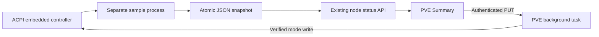

# Proxmox VE temperatures and fan control

Tested with PVE 8.4.19 and Linux 6.8.12-30-pve on the ASUS VC66-C2, BIOS 1602. This is a local extension to PVE package files. The installer refuses source layouts whose anchors do not match; fan control additionally requires a verified DMI/BIOS profile.

## Install

Clone or copy the full repository onto the host. From its root, choose one installation:

```sh
# Temperatures and standard hwmon fan sensors only.
sudo python3 pve/install.py install

# Or: temperatures, cached EC RPM and Normal/full-speed buttons.
sudo python3 pve/install.py install --fan-control

sudo python3 pve/install.py status
```

For an existing installation, remove it with the current checkout's installer before reinstalling. Then reload the browser and open **Node → Summary**. The new JavaScript has a versioned URL to avoid reusing the old extension from browser cache.

The summary shows CPU package/core, NVMe, SATA and ACPI temperatures. The fan-enabled installation adds CPU fan RPM, the observed mode, and **Normal** / **Full speed** buttons. Values update through normal node-status polling. Missing or expired data is shown as unavailable, never fabricated as zero. The currently active mode's button is disabled. Pending operations disable both buttons; failures are shown inline. No page-wide loading mask or blocking browser request is used.

Normal enables the firmware automatic policy; Full speed disables QFan. The selected mode is runtime state and lasts until firmware changes it or the host restarts. Closing the page or stopping the monitor does not restore Normal automatically. Select Normal before removing the extension if that is the desired policy. Quiet and arbitrary duty cycles are not exposed.

## Permissions and API

Viewing node status uses the existing `Sys.Audit` permission. Changing mode requires **`Sys.Modify` on `/nodes/<node>`**. `root@pam` has it; the standard **PVEAdmin role does not**. The installer does not change users, roles or ACLs. Accounts without the privilege can view RPM and mode, with disabled buttons and an explanation.

The control endpoint is:

```text
PUT /api2/json/nodes/{node}/localfan
mode=normal | full-speed
```

It uses normal PVE authentication, CSRF checks for cookie authentication, protected execution and node proxying. The request returns a PVE task UPID promptly. The task performs the bounded hardware operation, verifies readback and refreshes the cache. Task failures appear in the normal PVE task log and inline in the summary. An unconfirmed request is never retried automatically.

Local root CLI examples:

```sh
pvesh set /nodes/localhost/localfan --mode full-speed
pvesh set /nodes/localhost/localfan --mode normal
```

## How status polling stays independent of EC latency



`asus-ec-fan.service` launches one sample process about every five seconds, with a three-second sample deadline. It uses the existing profile guards and process lock. A failed sample leaves the last complete cache in place; a stalled process prevents further samples instead of accumulating overlapping hardware workers. The service does not change fan policy on startup or during polling.

The node API reads only `/run/asus-ec-fan/status.json` for EC information. It accepts a regular file up to 4 KiB, opens nonblocking without following symlinks, validates the profile and data, and rejects samples aged 15 seconds or more. No EC access or subprocess is introduced into node-status polling. Existing temperature collection continues to read standard hwmon attributes.

The browser also expires readings if status updates stop arriving. Stale or unavailable data disables control. Mode-change tasks wait briefly for an in-flight sample, then use the CLI's independent restoration watchdog and readback checks. Only verified modes can be written. The shared lock coordinates this project's monitor and CLI, not firmware or other EC utilities. Avoid running unrelated EC tools concurrently.

## Installed files and service

All installations modify or add:

```text
/usr/share/perl5/PVE/API2/Nodes.pm
/usr/share/pve-manager/index.html.tpl
/usr/local/share/pve-local-thermal/LocalThermal.pm
/usr/share/pve-manager/js/local-thermal.js
/etc/modules-load.d/pve-local-thermal.conf
```

The fan option also installs:

```text
/usr/local/share/pve-local-thermal/asus_ec.py
/usr/local/share/pve-local-thermal/fan-cache.py
/usr/local/share/pve-local-thermal/FanAPI.pm
/etc/systemd/system/asus-ec-fan.service
```

Backups and the active hash manifest are under `/var/lib/pve-local-thermal/`. The installer loads `coretemp` and `drivetemp`, enables the optional fan monitor, and reloads `pvedaemon` / `pveproxy`. It does not reboot or restart VMs. Each EC operation disables write access and unloads the module it loaded when finished; the monitor performs only reads.

Useful checks:

```sh
sudo python3 pve/install.py status
systemctl status asus-ec-fan.service
journalctl -u asus-ec-fan.service -n 30
```

If EC readings stop, temperatures and the rest of the summary remain available. Check the service log before retrying control. An already-loaded `ec_sys` module is preserved by reads; mode changes refuse to alter its existing configuration. Investigate the owner of such a module before unloading it.

## Remove or upgrade

Use the current version of the installer:

```sh
sudo python3 pve/install.py remove
```

This checks tracked hashes, stops/disables the installed fan monitor, restores original package files and removes added files. Backups remain; already loaded temperature drivers remain until reboot. Reload the browser afterward.

Before upgrading PVE, remove the extension. After upgrading, review compatibility, run the UI test against the new PVE assets, then reinstall with the same fan option. There is no automatic package-update hook. If package updates or local edits changed a tracked file, removal refuses to overwrite it: review the manifest and reconcile the small hooks with the current package version. Do not restore an old whole-file backup over a newer package.

See [tests and Ext JS compatibility](testing.md). Keeping override methods non-strict is essential to PVE's `callParent()` behavior.
