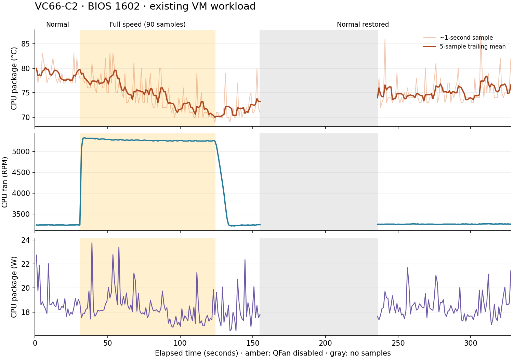

# VC66-C2: a verified ASUS EC fan-control profile

Investigated on 2026-11-17: ASUS MINIPC VC66-C2, i5-10400, BIOS 1602 (2021-12-01), Linux 6.8.12-30-pve, PVE 8.4.19. This is the first tested profile for ASUS EC fan control, not a claim that its register map applies to every ASUS computer.

## Result and live validation

Direct EC access provides CPU fan RPM and the BIOS fan modes. A bounded ten-second test changed only EC byte `0x2c` from `0x00` to `0xf0`, then restored `0x00`:

| Stage | Mode byte | CPU fan RPM |
| --- | --- | --- |
| Before | `0x00` | 3,237 |
| QFan disabled | `0xf0` | 5,061 initially; approximately 5,300 afterward, peak 5,324 |
| Immediately restored | `0x00` | 5,259, while the fan decelerated |
| Settled after restoration | `0x00` | 3,267 |

Readback confirmed the original mode and bank zero. EC write access was disabled and the temporary module unloaded. No BIOS variable was written, no BIOS was flashed, and no reboot or VM restart was required. A subsequent three-second test of the packaged CLI reproduced the speed increase and restoration.

Normal and full-speed mode writes are verified. Quiet exists in the BIOS definitions but has not been tested. No arbitrary duty-cycle or custom-curve interface has been established.

## CPU temperature comparison

A follow-up test on the same host retained the existing VM workload. It collected 30 baseline samples, 90 full-speed samples, and 30 samples after restoring Normal, at approximately one-second intervals (155 seconds including measurement overhead). A later read-only observation added 90 Normal-mode samples. The gap between runs is shown explicitly in the chart and CSV; no fan writes occurred during the recovery run.

The table uses the **last 20 samples of each phase**, selected consistently to reduce the effect of the mode transition:

| Phase | CPU package | Fan RPM | CPU busy | Package power |
| --- | ---: | ---: | ---: | ---: |
| Normal baseline | 78.6 °C | 3,241 | 16.7% | 18.46 W |
| Full speed, end of ~90-second interval | 71.5 °C | 5,249 | 17.4% | 17.83 W |
| Normal restored, first ~30 seconds | 72.2 °C | 3,235 | 17.7% | 18.20 W |
| Normal, later read-only recovery observation | 76.4 °C | 3,266 | 17.7% | 18.71 W |

The full-speed window was approximately **7 °C cooler** than the Normal baseline. CPU utilization stayed close to 17%; package power was 0.63 W lower in the full-speed comparison window. This single-cycle observation reflects a live workload with variable power. Room temperature and steady-state thermal performance were not measured. The short initial recovery is consistent with the heatsink taking time to warm back up; the longer follow-up shows the subsequent trend.

Temperature comes from the `coretemp` package sensor. CPU busy is calculated from aggregate `/proc/stat` deltas (excluding idle and I/O wait); package power is the change in the Intel RAPL package energy counter divided by elapsed time. The CSV also includes mean reported CPU frequency. No synthetic CPU load was started.



[Download the measurements as CSV](data/vc66-c2-1602-thermal-comparison.csv). The machine was left in Normal mode with `ec_sys` unloaded.

## Register map for this profile

| Bank-zero EC offset | Meaning | Evidence |
| --- | --- | --- |
| `0xff` | Bank selector; required value `0x00` | Firmware explicitly selects bank zero; observed zero on the host |
| `0x2c` | Fan mode: Normal `0x00`, Quiet `0x01`, QFan disabled `0xf0` | BIOS callback and IFR definitions; Normal/full speed verified live |
| `0xb0` | CPU fan RPM high byte | Firmware sensor provider and live RPM changes |
| `0xb1` | CPU fan RPM low byte | Firmware sensor provider and live RPM changes |
| `0x3b` | CPU temperature byte | Sensor-provider entry and HWM label mapping; not used by the CLI |

Firmware combines RPM as `(high << 8) | low` and reports zero below 165. The tool reads high/low/high to detect rollover, checks bank and mode before and after sampling, and retries unstable readings. These checks do not provide an atomic snapshot against firmware.

Additional temperature entries refer to `0x3c`, `0x3e` and `0x3f`; their physical locations are not established. They are not exposed by the tool. Normal Linux `coretemp`, `nvme`, `drivetemp` and `acpitz` remain the temperature sources used by the PVE extension.

## Firmware evidence and transport

Official [ASUS BIOS downloads](https://www.asus.com/supportonly/vc66-c2/helpdesk_bios/) were extracted offline with [UEFITool / UEFIExtract](https://github.com/LongSoft/UEFITool) and [IFRExtractor-RS](https://github.com/LongSoft/IFRExtractor-RS), then analyzed in Ghidra 12.1.4 via [Ghidra MCP](https://github.com/bethington/ghidra-mcp). The firmware images were not installed.

### BIOS mode callback

In BIOS 1602, the `Setup.efi` callback at Ghidra address `0x184dc` reads the `Setup` variable under GUID `ec87d643-eba4-4bb5-a1e5-3f3e36b20da9`, then locates EC protocol `2b2b7433-ee73-4181-85dd-4beb3c003c3d`.

The IFR definitions tie the following options to the callback:

| Question | Question ID | Setup offset | Values |
| --- | --- | --- | --- |
| CPU QFan | `0x282e` | `0x76b` | Enabled `0x00`, Disabled `0xf0` |
| CPU Fan Control | `0x282f` | `0x76c` | Normal `0x00`, Quiet `0x01` |

The callback selects EC bank zero with protocol selector 6 and writes `0x2c`: `0xf0` when QFan is disabled, otherwise the selected fan-control value. Assembly confirms the third argument of the bank-selection write is zero; Ghidra's initial inferred function signature omitted it. The callback then saves the BIOS variable. The Linux tool reproduces only the runtime mode write, not the variable update or bank-selection write.

### ACPI EC transport

`DxeFramework.efi` installs the protocol at callback `0x190c`. Its read-byte routine at `0x1bd8` sends command `0x80`, the byte address, then reads the result. Its write-byte routine at `0x1cbc` sends command `0x81`, address and value. The port table maps selector 6 to command/status port `0x66` and data port `0x62`.

These are standard ACPI EC operations. The running kernel reports the active device as `\_SB.PCI0.LPCB.EC0`, using those ports and GPE `0x4f`. Linux [`ec_sys`](https://github.com/torvalds/linux/blob/v6.8/drivers/acpi/ec_sys.c) routes debugfs reads and writes through `ec_read()` and `ec_write()`. This lets the tool use the kernel EC transport without opening `/dev/port`, `/dev/mem`, or a vendor raw-I/O driver.

### Sensor provider and chip identity

`HWMSensorInterface.efi` uses the same protocol. Its table at `0x950` maps fan sensor ID `0x1b1c` to `0xb0`/`0xb1`; the RPM reader is at `0x3e8`. CPU temperature ID `0x1b07` maps to `0x3b`.

Both official images include a module named `ITE8225DxeInit.efi`. This identifies an ITE IT8225 firmware target; the physical chip marking has not been inspected. A limited Super I/O probe separately returned unknown ID `0x8220` at `0x2e`. That probe result is not a confirmed chip model and must not be relabeled IT8220. This host's SMBIOS type 34 contains a generic `LM78-1` entry at address zero, which does not independently confirm IT8225.

### Reproducibility identifiers

Relevant extracted PE32 image hashes (not the complete capsule hashes):

| Module | SHA-256 | Comparison |
| --- | --- | --- |
| `ITE8225DxeInit.efi` | `d71f7f7971d52b60b3ac8d26ed2b87999f444355c22af80cdbe667b277b6a83a` | Identical in 1602 and 1603 |
| `HWMSensorInterface.efi` | `a022ce5e1bceb9338217ae6d4da193eca4bfccd76f1e01d317a55081de1cab1a` | Identical in 1602 and 1603 |
| `WmiRmtApi.efi` | `ffb1aeec3638339b683aea186ce56ad5e878f72b6a343ee5df374896a7013e3a` | Identical in 1602 and 1603 |
| `Setup.efi` (1602) | `6ef0dfb396769591cc6acedb7c50697d1a962646197aff91d00c34d841918bf6` | Addresses above refer to this version |
| `DxeFramework.efi` (1602) | `bfbbd127fb1f58578919438fbfe96b707f8fd48da8416bb69300589370fa3a19` | Addresses above refer to this version |

Module GUIDs: ITE initializer `85d91856-70a3-411d-9612-4531c060d867`; sensor provider `062a6204-8c80-4a27-9d09-96654c965894`; WMI SMI handler `6b35fef5-022f-4596-8422-59afa264c03a`.

Matching modules do not establish whole-firmware equivalence. BIOS 1603 has not been tested on hardware and is not enabled in the CLI profile list.

## Why the advertised WMI fan interface did not work

ASUSManagement WMI GUID `97845ed0-4e6d-11de-8a39-0800200c9a66` maps to `\AMW0`. The firmware's binary MOF descriptor, decoded with [bmfdec](https://github.com/pali/bmfdec), and the DSDT agree on this mapping:

| Method | ACPI method | WMI method ID | SMI function |
| --- | --- | --- | --- |
| GetFanPolicy | `GFAN` | `0x4746414e` | `0x80000010` |
| SetFanPolicy | `SFAN` | `0x4446414e` | `0x80000011` |
| GetManualFanCurve | `GFCV` | `0x47464356` | `0x80000012` |
| SetManualFanCurve | `SFCV` | `0x44464356` | `0x80000013` |

The setter IDs spell DFAN/DFCV in bytes despite the SFAN/SFCV method names. Use the observed numeric values, not values guessed from names.

`WmiRmtApi.efi` registers an SMI `0xda` callback at `0x1500`. The getter cases `0x80000010` and `0x80000012` merely clear the error field; they do not populate fan policy or curve data. Setter cases `0x80000011` and `0x80000013` set error code 3, the handler's unsupported path. This handler is byte-identical in the inspected BIOS 1602 and 1603 images.

Live GFAN queries for selectors 0–3 returned 80 zero bytes each. A different read-only query through the same transport returned populated data, confirming that the debugger transport itself worked. The SMI analysis explains the empty fan replies. No WMI fan setter was invoked.

The descriptor lists fan type, mode, low limit and profile/curve fields, but those logical types do not establish a functional serialization layout. `tools/probe_fan_policy.py` remains a WMI-only diagnostic. `control_supported: false` means that its response has not established WMI control, not that direct EC control is unavailable.

The conventional ASUS WMI DSTS fan-device IDs `0x00110011` and `0x00110013` returned zero. `DEVS`, and the DSDT's generic RDEC/WREC helpers, are also stubs in this firmware. A separate `H_EC` definition contains a `CFAN` field but has `_STA` returning zero; that disabled reference device is not a valid register map for the active EC.

For occasional WMI diagnostics only:

```sh
sudo python3 tools/probe_fan_policy.py --fan-selector 0 1 2 3
```

This requires the [Linux AML debugger](https://docs.kernel.org/firmware-guide/acpi/aml-debugger.html) already exposed at `/sys/kernel/debug/acpi/acpidbg`. It temporarily adjusts debugger output flags and restores them on handled exit. Do not run it with another debugger session or as a polling loop; forced termination cannot guarantee flag restoration.

## Windows application call chains

The [official ASUS downloads](https://www.asus.com/supportonly/vc66-c2/helpdesk_download/) supplied ASUS Business Manager 2.13.02 and Remote Management Tool 2.1.0.6. Their installers, libraries and drivers were extracted and analyzed statically; they were not installed or executed.

- `ASUS_WMI.dll`: exported `read_ec` at `0x1000a870` reaches the WMI helper at `0x10009600`, invoking `asio_hw_fun28` with Index/Data properties. This is a generic EC wrapper, not evidence that the board implements every wrapped method.
- `aaHMSvc.exe`: `AcpiSetItem` is called through `0x00409400`. One caller at `0x0041b1fc` sets item `0x11060004` to 1 after a support check. Its meaning has not been established as fan-mode control; it must not be treated as such just because the service also has fan labels.
- `AsAcpi.dll`: exported `AcpiSetItem` at `0x100138c0` dispatches through a driver/COM abstraction. The direct branch uses `ATKACPI`; the COM branch loads `asacpiEx.dll`.
- `asacpiEx.dll`: `AcpiSetItem` at `0x0040263c` reaches `0x00402654`, creates COM object `atkexCom.axdata` and invokes `iAcpiSetItem`.
- `atkexComSvc.exe`: contains `AsIO.dll`, `ASUS_WMI.dll`, hardware-monitor and Super I/O helper imports. This establishes available transports, not the exact fan-setting operation.
- Client `AsInsHelp.dll`: `IsFanControlSupported` at `0x10001820` performs initialization then unconditionally returns zero. SHA-256: `d55ab635bd6f1eaa945c8bb1469033000cf4325e9db32de6141df5f40d6c73c8`.

An exact successful Windows GUI fan-setting transaction on this machine has not been reproduced. The confirmed Linux implementation comes from the BIOS mode callback and sensor provider, supported by actual mode readback and RPM changes.

## Other ASUS boards and upstream Linux

A public [ASUS MINIPC PN50 DMI report](https://github.com/linuxhw/DMI/blob/master/Mini%20Pc/ASUSTek%20Computer/MINIPC/MINIPC%20PN50/86C8213ACE93) lists `ITE IT8225` as its management device. This is evidence that the firmware-reported EC family appears in another ASUS model; it does not establish the same bank, mode byte, fan count or RPM format.

The upstream [`asus_ec_sensors` documentation](https://docs.kernel.org/hwmon/asus_ec_sensors.html) lists supported ASUS motherboards and describes a board-specific ACPI mutex for EC access. VC66-C2 and PN50 are not listed there at the time of investigation. That driver is a sensor reader, not a generic IT8225 fan-control driver. The tool's process lock is not a replacement for a verified firmware mutex.

The [PVE integration](pve.md) now displays cached EC RPM and provides authenticated Normal/full-speed controls. Next useful contributions are verified profiles for additional ASUS firmware layouts, firmware-lock identification, and an upstream hwmon interface. A shared EC name, generic Windows export, or matching-looking ACPI field alone is not sufficient to enable writes.
